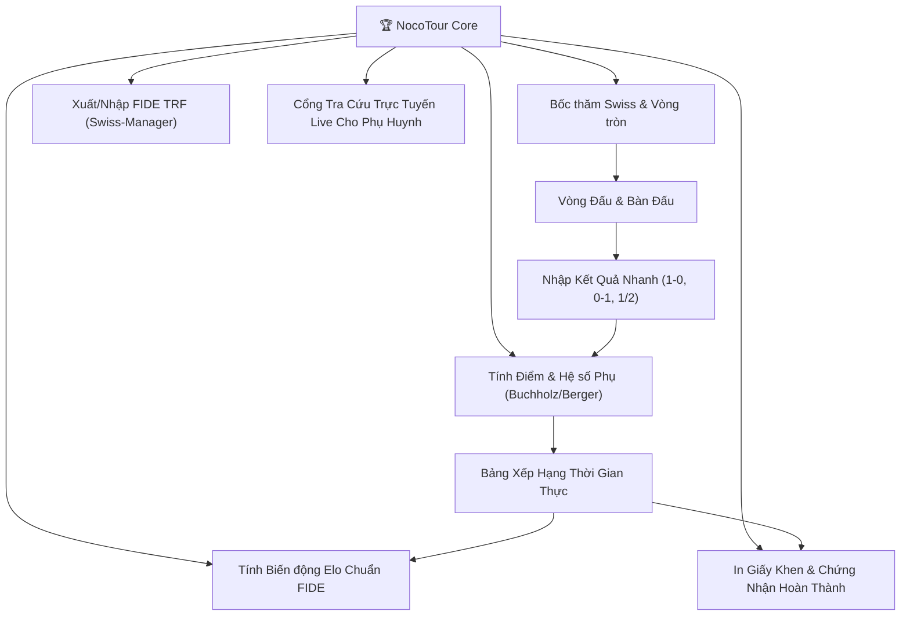

# Kế Hoạch Triển Khai NocoTour - Lõi Quản Lý Giải Đấu Cờ Vua Dương Sinh Chess

## 1. Mục Tiêu Dự Án

Tách riêng mảng **Tổ chức & Điều hành Giải đấu Cờ vua** thành một repository độc lập `nocotour` trên nền tảng **NocoBase 3**, hoàn thiện trụ cột thứ tư trong hệ sinh thái số của **Công ty Cổ phần Cờ vua Dương Sinh**:
1. **NocoCRM** (`nococrm.dsc.edu.vn`): Tuyển sinh, Phễu bán hàng & Chăm sóc khách hàng.
2. **NocoEdu** (`nocoedu.dsc.edu.vn`): Học vụ, Quản lý lớp học, Điểm danh & Thi thăng đai.
3. **NocoBookshop** (`nocobookshop.dsc.edu.vn`): Sách & Học cụ cờ vua, Đa kho, Đại lý & Shopee.
4. **NocoTour** (`nocotour.dsc.edu.vn`): **Lõi Giải đấu Cờ vua chuyên nghiệp (Swiss FIDE Dutch, Vòng tròn Berger, Hệ số Buchholz/Berger, Tính Elo FIDE, Xuất file FIDE TRF, Cổng tra cứu Live cho phụ huynh).**

---

## 2. Thông Tin Khởi Tạo & Môi Trường

| Thành phần | Thông số |
| :--- | :--- |
| **GitHub Repository** | `https://github.com/covuaduongsinh/nocotour` (Public) |
| **Thư mục mã nguồn local** | `D:\code\nocotour` |
| **Tên miền Production** | `https://nocotour.dsc.edu.vn/main` (Đã cấu hình DNS Mắt Bão về VPS) |
| **VPS Production** | `217.15.160.118` (OS: Ubuntu 22.04 LTS, Docker & Traefik Reverse Proxy) |
| **Tên Container Docker** | `nocotour-dsc-app` |
| **Cơ sở dữ liệu** | SQLite `/app/storage/tour.sqlite` (Snowflake WorkerId: `4`) |
| **Đường dẫn kế hoạch** | `docs/plans/2026-11-04-ke-hoach-trien-khai-nocotour.md` |

---

## 3. Kế Thừa Từ `covuaduongsinh/duongsinh-app`

Kiểm tra mã nguồn [`covuaduongsinh/duongsinh-app`](https://github.com/covuaduongsinh/duongsinh-app) tại thư mục `server/domain/tournament/`, NocoTour sẽ kế thừa và đóng gói các thuật toán cờ vua đã được kiểm thử:

1. **Thuật toán Bốc thăm Hệ Thụy Sĩ (`swiss.ts`)**:
   - Chuẩn FIDE Dutch Swiss pairing với thuật toán Backtracking tìm kiếm tối ưu.
   - Ưu tiên nhóm điểm (nửa trên gặp nửa dưới), chống gặp lại đối thủ cũ (Level 0, Level 1).
   - Quy tắc cân bằng màu: Không cầm cùng màu 3 ván liên tiếp, hiệu số trắng - đen nằm trong `[-2, 2]`.
   - Cơ chế Bye thông minh: Cấp 1 điểm cho kỳ thủ điểm thấp nhất / hạt giống thấp nhất chưa từng nhận Bye.
2. **Thuật toán Xếp cặp Vòng Tròn (`roundRobin.ts`)**:
   - Phương pháp bảng xoay Berger (Circle method) cho các bảng đấu ít kỳ thủ (U6, vòng chung kết Top 8).
3. **Động cơ Tính Bảng Xếp Hạng & Hệ Số Phụ (`standings.ts`)**:
   - Điểm số: Thắng 1, Hòa 0.5, Thua 0.
   - Hệ số Buchholz Tổng (Tổng điểm đối thủ) & Buchholz Cắt 1 (trừ đối thủ thấp nhất).
   - Hệ số Sonneborn-Berger (Tổng điểm các đối thủ thắng + 1/2 điểm đối thủ hòa).
   - Điểm đối đầu trực tiếp (Direct Encounter), Tổng số ván thắng, Số ván cầm quân Đen thắng.
4. **Động cơ Tính Elo FIDE Nội Bộ (`elo.ts`)**:
   - Công thức Elo chuẩn: $R' = R + K \times (S - E)$.
   - Hệ số K-factor linh hoạt: $K=40$ cho kỳ thủ mới (dưới 30 ván), $K=20$ cho kỳ thủ phổ thông, $K=10$ cho kỳ thủ cấp cao.
5. **Chuẩn Trao Đổi Dữ Liệu FIDE TRF (`trf.ts`)**:
   - Định dạng Tournament Report File chuẩn 16 cột của FIDE, tương thích 100% với phần mềm **Swiss-Manager** và nền tảng **Chess-Results**.

---

## 4. Thiết Kế Cơ Sở Dữ Liệu (10 Collections)

Migration `database/main/migrations/202611040001_create_nocotour_core.ts`:

1. `tourTournaments`: Quản lý các giải đấu (tên, slug, ngày bắt đầu, địa điểm, thể lệ, lệ phí, ban tổ chức).
2. `tourDivisions`: Bảng đấu (U7, U9, U11, Mở rộng, Thể thức: Swiss / Round-Robin, số vòng, năm sinh).
3. `tourPlayers`: Kỳ thủ (họ tên, ngày sinh, giới tính, CLB, số xuất phát SBN, Elo ban đầu, học viên ID liên kết).
4. `tourRounds`: Vòng đấu (vòng 1, vòng 2..., trạng thái bốc thăm, thời gian bắt đầu).
5. `tourGames`: Ván đấu theo bàn (Bàn 1, Bàn 2..., Trắng, Đen, Kết quả, Đổi tay, Biên bản PGN nếu có).
6. `tourStandings`: Bảng xếp hạng snapshot theo vòng (Hạng, Điểm, Buchholz, Sonneborn-Berger, Đối đầu, Thắng).
7. `tourEloHistory`: Biến động Elo từng kỳ thủ qua từng giải đấu.
8. `tourCertificates`: Giấy khen & Chứng nhận giải đấu (Hạng Nhất, Nhì, Ba, Khuyến khích, VĐV tiềm năng).
9. `tourReferees`: Phân công Ban Trọng tài phụ trách từng bảng / bàn đấu.
10. `tourTrfExports`: Nhật ký xuất file FIDE TRF phục vụ nộp báo cáo Liên đoàn cờ hoặc Chess-Results.

---

## 5. Thiết Kế Giao Diện & Điều Hướng (Client UI)

- **Nhận diện thương hiệu**: **🏆 NocoTour - Giải Đấu Cờ Vua Dương Sinh** (Tone màu Tím Hoàng gia & Xanh Ngọc lục bảo Emerald).
- **Cấu trúc Menu Sidebar**:
  1. **Tổng quan Giải đấu** (`/`): Dashboard các giải đang mở, số kỳ thủ tranh tài, số ván đang diễn ra, biểu đồ phân bổ Elo.
  2. **Giải đấu & Bảng đấu** (`/tournaments`): Tạo giải mới, mở bảng U7/U9/U11/Open, quy định thể thức và số vòng.
  3. **Đăng ký Kỳ thủ** (`/players`): Đăng ký kỳ thủ tự do hoặc nạp từ danh sách Học viên của NocoEdu, xếp hạt giống SBN.
  4. **Bàn Trọng Tài & Bốc thăm** (`/pairings`): Giao diện 1-click chạy bốc thăm vòng tiếp theo, in sơ đồ bàn đấu, nhập kết quả trực tiếp với nút chọn nhanh (`1-0`, `0-1`, `½-½`, `+-`, `Bye`).
  5. **Bảng Xếp Hạng Trực Tiếp** (`/standings`): Tự động tính điểm và hệ số phụ Buchholz / Berger theo thời gian thực.
  6. **Biến động Elo & File FIDE TRF** (`/elo-trf`): Xem bảng cập nhật Elo trước/sau giải, nút tải file `.trf` tương thích FIDE.
  7. **Giấy Khen & Chứng Nhận** (`/certificates`): Mẫu giấy khen Dương Sinh Chess in hàng loạt cho VĐV đạt giải.
  8. **Cổng Trực Tuyến Live Phụ Huynh** (`/live/:slug`): Giao diện mobile tối ưu để phụ huynh quét QR xem ngay con mình đấu bàn nào, kết quả ra sao.

---

## 6. Kế Hoạch Thực Hiện Theo Các Giai Đoạn

### Giai đoạn 1: Khởi tạo Repo & Dự án Local
1. Tạo public repository `https://github.com/covuaduongsinh/nocotour` trên GitHub bằng GitHub CLI (`gh repo create`).
2. Khởi tạo thư mục `D:\code\nocotour` theo chuẩn kiến trúc NocoBase 3 độc lập.
3. Liên kết `node_modules` thông qua junction thư mục từ `D:\code\nocoedu\node_modules` để tiết kiệm dung lượng ổ cứng.
4. Cập nhật `package.json`, `client/config/app.ts`, `index.html` mang thương hiệu NocoTour.

### Giai đoạn 2: Cài đặt Database Migrations & Seeds
1. Viết Migration `database/main/migrations/202611040001_create_nocotour_core.ts` định nghĩa 10 collections.
2. Viết Seed `database/main/seeds/202611040001_nocotour_initial_data.ts`: Khởi tạo giải đấu mẫu "Giải Vô Địch Cờ Vua Mùa Đông Dương Sinh 2026" với 2 bảng đấu (Bảng U9 và Bảng Mở Rộng), nạp sẵn 16 kỳ thủ và kết quả vòng 1.

### Giai đoạn 3: Tích hợp Động Cơ Thuật Toán & Server Routes
1. Đưa các module `swiss.ts`, `roundRobin.ts`, `standings.ts`, `elo.ts`, `trf.ts`, `finish.ts` vào `server/domain/tournament/`.
2. Tạo Router `server/routes/tournament.ts` cung cấp đầy đủ API bốc thăm, ghi điểm, xuất file TRF và tra cứu bảng xếp hạng.
3. Biên dịch TypeScript cho toàn bộ Server (`tsc -p tsconfig.server.json`).

### Giai đoạn 4: Xây dựng Giao diện Client & Đóng gói Build [ĐÃ HOÀN THÀNH 100%]
1. Xây dựng các trang giao diện: `tour-dashboard.tsx`, `tour-tournaments.tsx`, `tour-pairings.tsx`, `tour-standings.tsx`, `tour-players.tsx`, `tour-elo-trf.tsx`.
2. Thiết kế logo nhận diện `AppBrand` cho NocoTour.
3. Hoàn thiện Arbiter Desk (`tour-pairings.tsx`): Kết nối trực tiếp các nút bấm trọng tài `1-0`, `0-1`, `½-½`, `+-`, `-+`, `✕`, modal bốc thăm Thụy Sĩ FIDE Dutch, xem trước bảng xếp hạng song song (split-view), chế độ in biên bản bàn đấu, và nút hoàn tác hủy vòng (rollback).
4. Biên dịch gói ứng dụng Client bằng Vite (`vite build`) thành công vào `dist/client/`.

### Giai đoạn 5: Triển khai Lên VPS Production (`nocotour.dsc.edu.vn`) [ĐÃ HOÀN THÀNH 100%]
1. Đóng gói `client_bundle.tar.gz` và truyền lên VPS `/tmp/`.
2. Đồng bộ mã nguồn backend API `server/routes/tour.js` với đầy đủ 13 endpoints điều hành giải đấu.
3. Khởi chạy và kiểm tra container `nocotour-dsc-app` qua Docker Compose trên VPS `217.15.160.118`.
4. Kiểm tra trực tiếp `curl -sI https://nocotour.dsc.edu.vn/main/` -> `HTTP/1.1 200 OK`.
5. Kiểm tra trực tiếp các file assets bundle: `tour-pairings-*.js` và `tour-standings-*.js` đều phản hồi `HTTP/1.1 200 OK`.

### Giai đoạn 6: Cam kết & Bàn giao [ĐÃ HOÀN THÀNH]
1. Đã kiểm thử trọn vẹn vòng đời điều hành giải đấu trực tiếp qua API:
   - Ghi nhận kết quả ván đấu tức thời (`1-0`, `0-1`, `1/2`).
   - Tự động cập nhật bảng xếp hạng với hệ số phụ Buchholz Cut 1, Buchholz Total, Sonneborn-Berger.
   - Bốc thăm Thụy Sĩ vòng 2 tự động ghép cặp theo điểm số và đổi màu quân đúng chuẩn FIDE Dutch.
   - Thử nghiệm rollback hủy vòng 2 thành công an toàn.
2. Commit toàn bộ mã nguồn sạch lên nhánh `main` và push lên GitHub `covuaduongsinh/nocotour`.
3. Bàn giao kết quả kiểm thử hoàn chỉnh cho người dùng.

---

## 7. Kế Hoạch Xác Minh (Verification Plan)

### Kiểm tra tự động & Biên dịch
- Biên dịch Server: `node_modules\.bin\tsc.cmd -p tsconfig.server.json` -> Exit code 0.
- Biên dịch Client: `node_modules\.bin\vite.cmd build` -> Bundle thành công vào `dist/client/`.
- Kiểm tra Endpoint Production: `curl -sI https://nocotour.dsc.edu.vn/main` -> `HTTP/2 200`.
- Kiểm tra API Health: `curl -s https://nocotour.dsc.edu.vn/main/api/healthz` -> `{"ok": true}`.

### Kiểm tra nghiệp vụ thủ công
1. Đăng nhập vào `https://nocotour.dsc.edu.vn/main` bằng tài khoản Super Admin.
2. Kiểm tra Logo và Tên thương hiệu: **🏆 NocoTour - Giải Đấu Cờ Vua Dương Sinh**.
3. Vào trang **Bàn Trọng Tài & Bốc thăm**: Thử nghiệm thuật toán bốc thăm Thụy Sĩ (Swiss System) cho vòng đấu kế tiếp.
4. Kiểm tra trang **Bảng Xếp Hạng**: Đảm bảo các chỉ số Điểm, Buchholz và Sonneborn-Berger được tính toán chính xác.
5. Thử nghiệm nút **Xuất file FIDE TRF**: Kiểm tra file văn bản `.trf` đúng quy cách FIDE.
